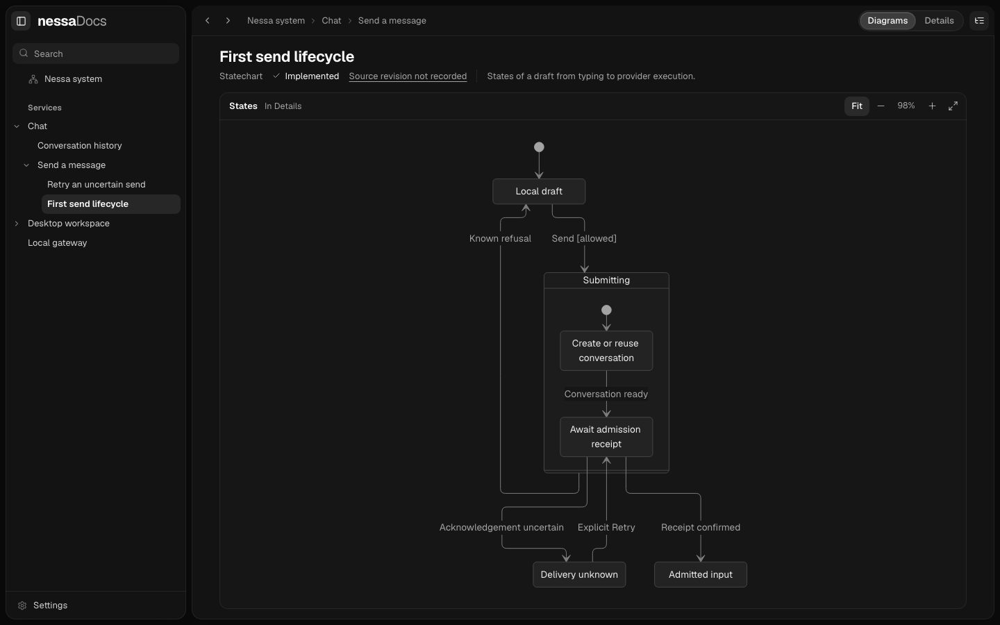
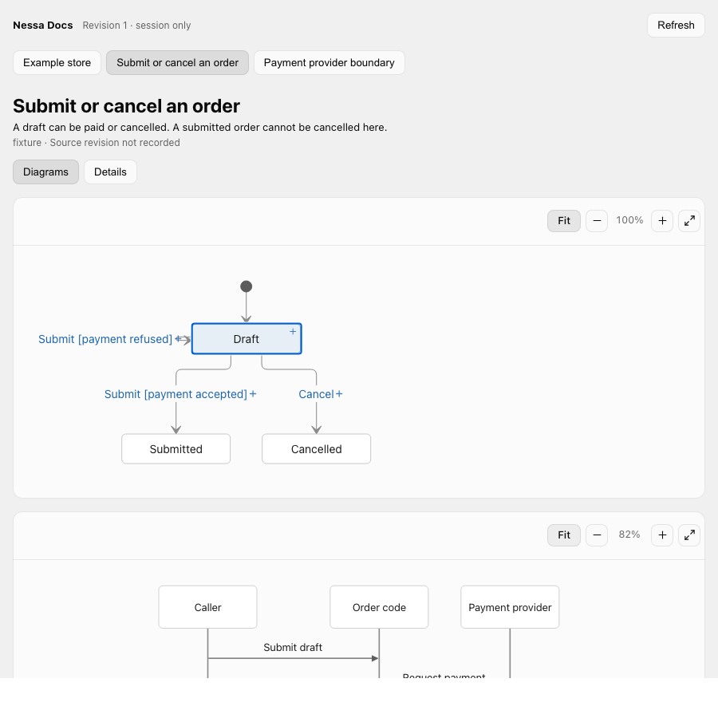

# Nessa Docs

Nessa Docs is a local reader for system maps kept beside a project's code. Start
with `docs/state/README.md`, follow a component into its own page, and open the
explanation attached to a state or transition. The pages are Markdown with
Mermaid diagrams, so they remain useful without the app.



*A statechart from the included fixture project. The boxes and transitions come
from authored Markdown.*

The browser reads documentation; it does not generate it or run the system in
the diagrams. The included [authoring skill](skills/nessa-docs/SKILL.md) helps a
coding agent write and maintain those pages from source evidence. Nessa Docs
works independently of the Nessa agent backend.

Working on this repository? [AGENTS.md](AGENTS.md) has the setup commands,
code map, and checks for contributors and coding agents.

## Try the local browser

Use Node.js 22.13+ within the 22.x line, 24.x, or 26+. The local reader runs on
macOS and Linux; native Windows path handling is not part of this release.

```sh
git clone https://github.com/nessalabs/nessa-docs.git
cd nessa-docs
npm ci
npm run build
npm start
```

Open [localhost:4311](http://127.0.0.1:4311) and choose **Browse example**. To
read another project, choose **Open project** and select or enter its folder.
That folder needs a `docs/state/README.md`. The macOS app can open a native
folder chooser; Linux uses path entry in this release.

The browser reads local files. It does not upload a project, edit its pages, or
run a coding agent. Use **Diagrams** for charts and **Details** for the complete
page and its sources. Drag a chart to pan; use Zoom or Fit to change its scale.
A box or arrow with a **+** opens an explanation or a deeper page.

## Write docs for your project

Copy the skill into the repository you want to document:

```sh
mkdir -p /path/to/your-project/.agents/skills
cp -R skills/nessa-docs /path/to/your-project/.agents/skills/
```

Run these commands from this Nessa Docs checkout. Then ask your coding agent:

> Use the nessa-docs skill to map this project's system and important user
> flows in docs/state. Read the source, explain the main states and decisions in
> plain English, and mark anything proposed or not yet verified.

If the project has an `AGENTS.md`, you can point it to
`.agents/skills/nessa-docs/SKILL.md` so later agents find the same format. The
[format reference](skills/nessa-docs/references/format.md) defines page metadata,
hierarchy, links, and chart explanations. The [small store example](examples/store)
shows a complete map without requiring a real payment provider or database.

Check the files before browsing them:

```sh
npm run --silent validate:docs -- --project /absolute/path/to/your-project
```

The validator checks structure, links, and diagram bindings. It cannot prove
that the prose matches the source; review the pages against the code they cite.

## Use it through MCP

The optional MCP server lets an agent create or update a document bundle and
show the same explorer in a host that supports MCP Apps. It is separate from the
localhost browser. A local Codex installation can register the built stdio
server from this checkout:

```sh
codex mcp add nessa-docs -- node "$PWD/dist/server/server/mcp/main.js"
```

Start a fresh chat after registration or a rebuild. To try it with synthetic
content, ask the agent:

> Use the nessa-docs MCP tools. Read the current bundle. If it is empty, load
> `examples/mcp/replace-docs.json` at revision 0, then call `show_docs`.

The MCP tools do not read a source repository by themselves. For a real project,
have the agent read and author its `docs/state` pages, then submit the complete
bundle with `replace_docs`. The agent reads the current revision with
`read_docs` before replacing it; the explorer's **Refresh** button reads the new
version. The server keeps a bundle in memory by default, so a restart clears it.
[Opt-in local saving](docs/durable-bundles.md) keeps a generated bundle across
restarts.



*MCP explorer running in a local browser harness. A compatible host can render
this UI from `show_docs`; the separate desktop right-panel check is still
[open](docs/mcp-right-panel-plan.md).*

The server advertises a conversation-panel entrypoint, but each host decides
whether and where to show the UI. Clients without MCP Apps still receive the
document text. For ChatGPT plugin setup, remote connections, and current host
limits, see [MCP Apps](docs/mcp-app.md) and [host integration](docs/host-integration.md).

## Develop

```sh
npm run typecheck
npm test
npm run build
npm run verify:mcp
```

For local UI work, run `npm run dev:api` in one terminal and
`npm run dev:client` in another, then open
[localhost:5173](http://127.0.0.1:5173). Set the same `PORT` for both if you
change the default `4311` API port. `NESSA_DOCS_PROJECT` can select an absolute
project folder at startup.

See the [architecture](docs/architecture.md), [browser verification](verification/CHECKLIST.md),
and [third-party notices](THIRD_PARTY_NOTICES.md). Nessa Docs is MIT licensed.
