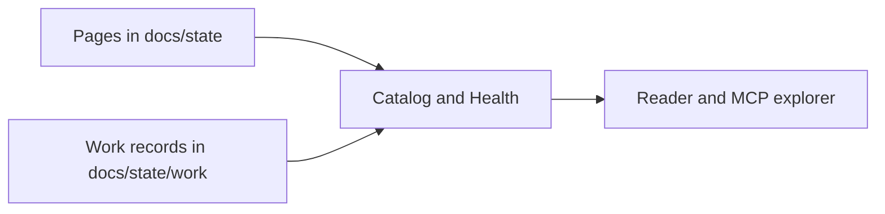

# Nessa Docs

Nessa Docs reads the Markdown under a project's `docs/state` folder and shows it
as a map of pages with charts. It never runs the system a chart describes.

These pages describe Nessa Docs itself. Most of how it works is in
[the architecture](../architecture.md). The pages here cover the parts that are
easiest to follow as a chart.

- [Track work on a chart](track-work/README.md): how agents record progress, and how
  the reader shows it.
