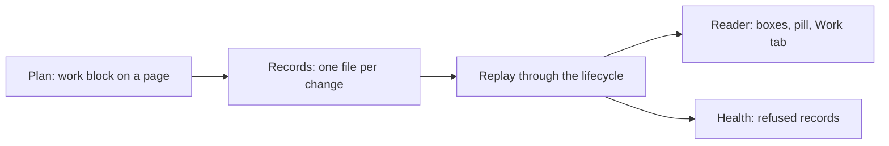

# Track work on a chart

Agents record progress as plain files in the repository. Nessa Docs only reads
those files and draws them. Nothing here needs the app to be open, and nothing
depends on which agent wrote a record or whether it is still running.

This page is itself tracked this way: its `work` block is the plan for building
the feature, and its records are in `docs/state/work/track-work/`.

## The plan

A page lists its tasks in a `work` block. Each task points at the box or arrow
it makes real, using the same `node` or `edge` form as `diagramDetails`. The
person reviews the plan like any other change to the page.

## The records

Each change of a task's state is a new file under
`docs/state/work/<page>/<task>/`. A record names the event (`start`, `submit`,
`merge` and so on), the state it leads to, when, and who wrote it. It is never
edited. A mistake is fixed by a newer record.

## The replay

Nessa Docs reads every record for a page, oldest first, and replays them
through [the lifecycle](work-lifecycle.md). A record whose event is not allowed
from the current state, or that lacks what the event needs, is refused. Health
lists it, and it does not move the box. The state the reader shows is worked
out from the records on every read. It is never saved anywhere else.

## What is built and what is not

Built: the lifecycle file, reading and checking records, the replay, the
reader's Work tab, box outlines and sidebar pill, the `stale` and quiet marks,
and the skill's "Track work" section. Not built: reading records from other
branches, and folding a finished task's records into one summary.
