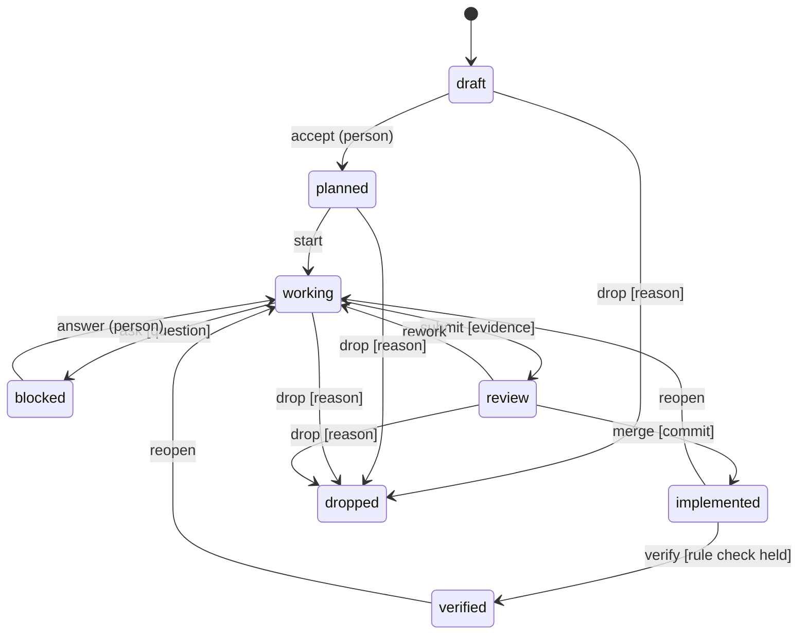

# Work lifecycle

Every chart page and every task is in exactly one of these states. The list is
fixed and ships with Nessa Docs in
[lifecycle.json](../../../skills/nessa-docs/references/lifecycle.json), so each
word means the same thing in every project and for every agent. The validator,
the reader and the skill all read that one file.

A `note` event keeps the current state. It is for something worth saying that
does not change where the work is.

One more state is never written, only shown: **stale**. A page that is
implemented or verified turns stale when one of its `sources` changed after its
`sourceRevision`. Open work is never stale.

## Blocked always carries a question

`ask` needs the question in the record's body, with the options and a
recommendation. Only a person listed under `work.people` in `nessa-docs.yaml`
may `answer`, and so `accept`. A file cannot prove who wrote it, so this is a
promise the project keeps, not something the reader can check.

## A page follows its tasks

A page with tasks takes its state from them. Its own records may only accept,
drop, verify or note it, so it is never ahead of its tasks:

- It is `review` only when every task that is not dropped is in review or
  finished.
- It is `implemented` only when every task that is not dropped is implemented.
- It is `verified` only while its saved rule check is fresh and names the same
  commit as its `sourceRevision`. Restamping the page without checking again
  takes `verified` away.

A page with no tasks moves on its own records.

## Rules the model checks

The model is one page with two tasks, replayed the way the code replays records.
It checks that a page is never finished while a task is open, that nothing is
implemented without a commit, that verified always names the page's stamp, and
that no task is worked on before the plan is accepted. A task may be dropped
from the draft. The model checks the design, not the code.
