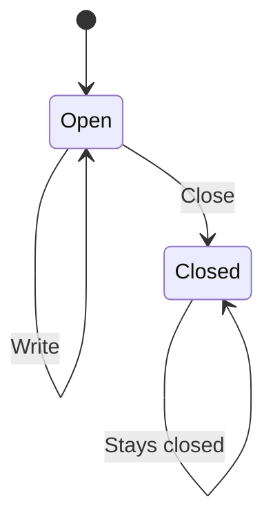

# Close an attachment

An open attachment can be closed. Writing is allowed only while it is open.
Closing does not erase bytes that were already stored. This page is a small
example. The model checks this design, not the code.

## What must always hold

A write never happens after the attachment is closed. The attachment is either
open or closed.
