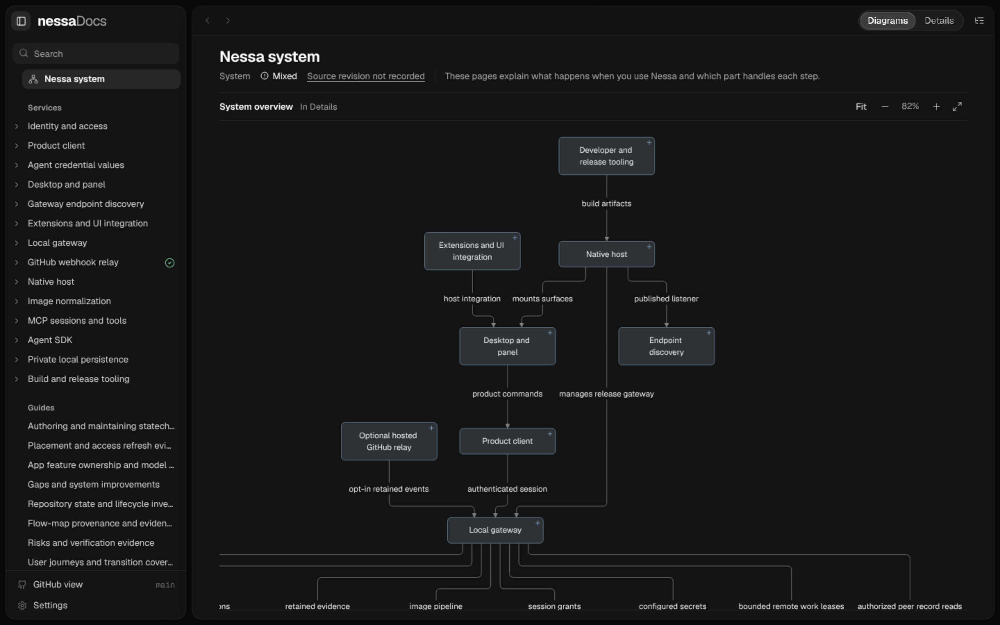

# Nessa Docs for GitHub

A Chrome and Firefox extension (one Manifest V3 codebase) that shows a
repository's `docs/state` folder on github.com in the Nessa Docs reader:
diagrams, linked pages, glossary terms and reference pills, the same as the
local app. Everything is read from GitHub as you browse; there is no server.



## Install

Store listings come later. Until then, download the build from this repository:

- Chrome (and Edge, Brave, Arc): [nessa-docs-chrome.zip](https://github.com/nessalabs/nessa-docs/raw/main/extension/downloads/nessa-docs-chrome.zip)
- Firefox 128+: [nessa-docs-firefox.zip](https://github.com/nessalabs/nessa-docs/raw/main/extension/downloads/nessa-docs-firefox.zip)

**Chrome**

1. Unzip `nessa-docs-chrome.zip` somewhere you will keep it (Chrome loads it from that folder).
2. Open `chrome://extensions` and turn on **Developer mode** (top right).
3. Click **Load unpacked** and pick the unzipped folder.

To update, replace the folder's contents with a newer download and click the reload arrow on the extension's card.

**Firefox**

1. Open `about:debugging#/runtime/this-firefox`.
2. Click **Load Temporary Add-on…** and pick `nessa-docs-firefox.zip` itself.

Firefox removes a temporary add-on when it restarts, because the build is not signed yet. To keep it, use Firefox Developer Edition or Nightly with `xpinstall.signatures.required` set to `false` in `about:config`, then install the zip from `about:addons` (gear menu, **Install Add-on From File…**). The store listing will remove this step.

Then open any `…/tree/<branch>/docs/state` folder on github.com, or a page in it.

## Build from source

```sh
npm ci
npm run build:extension    # dist/extension/chrome and dist/extension/firefox
npm run package:extension  # also refreshes extension/downloads/*.zip
```

Load `dist/extension/chrome` with **Load unpacked**, or `dist/extension/firefox/manifest.json` as a temporary add-on. After changing anything the extension ships (`extension/`, `src/`, `shared/`, `server/` code it imports), run `npm run package:extension` and commit the refreshed zips with the change, so the downloads match the code.

## How it works

| Piece | What it does |
| --- | --- |
| `src/content.ts` | Content script on github.com. Watches the address (GitHub moves between pages without reloading), finds a `docs/state` folder that has a `README.md`, shows an **Open in Docs** button, and starts the reader out of sight in an iframe so the button opens it at once. Keeps the address on the page the reader shows, so links and reloads open the same page. |
| `src/github-source.ts` | Reads the repository, pinned to one commit. First through the person's github.com session (GitHub's own folder JSON and `/raw/`), so private repositories work for anyone who can see them; public file text comes straight from raw.githubusercontent.com. Falls back to the REST API, with the optional token if one is saved. |
| `src/protocol.ts`, `src/port-client.ts` | The content script hands the reader a `MessagePort` once; all file requests go over it, out of reach of the GitHub page. |
| `src/reader.tsx` | The extension page in the iframe. Builds the catalog with the server's own code (`server/catalog.ts`, `server/responses.ts`) over files from GitHub, then draws the local app's `App` through a `ProjectSource` (`src/project-source.ts`). |
| `src/repo-files.ts` | The catalog's `RepositoryFiles` port over GitHub. |
| `src/file-cache.ts` | Keeps listings and file text in IndexedDB by commit, so a second visit needs no network. |
| `src/diagram-reader.ts` | Reads charts with Mermaid in the page, using the same `server/diagram-reading.mjs` the server's worker uses. |
| `src/shims/` | Browser stand-ins for the few Node modules the catalog imports (`path`, a synchronous SHA-256 for `crypto`, and two that are never reached). |
| `src/options.tsx` | Options: open folders in the reader at once (off by default) and an optional token. Both stay in this browser (`storage.local`). |

The reader says what it can do through `src/host.tsx` (`ReaderHost`): no folder
opening or rule checker here, and repository evidence links to the file on
GitHub.

### Opening the reader, and switching back

A docs folder starts on GitHub's own view with an **Open in Docs** button in the
corner. The reader reads the docs in the background as soon as the folder is
found, so the button opens it straight away. **GitHub view** at the foot of the
sidebar covers it again. The choice lasts for that folder in this tab. Turn on
"Open docs folders in the reader at once" in the options to skip the button.

### Kept in this browser

Everything the reader reads is kept in the extension's own storage, keyed by
commit, so opening the same docs again reads nothing from GitHub. A file at a
commit never changes, so a kept copy is never stale; a new commit is read fresh.
Copies not used for 30 days are dropped. Private repositories' text is kept the
same way, in this browser only.

### Private repositories and tokens

No token is needed while you are signed in to github.com. A token helps only
when the browser does not send the github.com session (for example strict
cookie settings). Use a fine-grained token with read-only **Contents** access to
the repositories you need. It is kept in this browser and sent only to
api.github.com. The extension ships no secrets.

### Limits

- Reads are pinned to the commit the page was opened at; Health → Reload reads
  that same commit. Reload the GitHub page to pick up new commits.
- The rule checker (TLC) needs the local app.
- GitHub's folder JSON is what github.com's own file view uses, not a published
  API. If its shape changes, the extension falls back to the REST API (60
  requests an hour without a token).

## Checks

```sh
npm test                  # includes extension/**/*.test.ts
npm run verify:extension  # builds, then drives Chromium against a stand-in github.com
```

`verify:extension` serves the bundled example store as if it were a GitHub
repository, so it needs no network or account. Playwright cannot load
extensions into Firefox, so Firefox is checked by hand.
