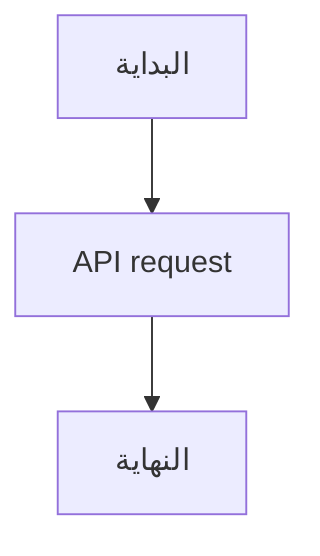

# دليل النظام

## قراءة مختلطة

هذه وثيقة عربية تتضمن خدمة API والرابط https://example.com/docs والمسار `src/main.tsx`.

English paragraphs retain their own reading direction in the Arabic interface.

| العنصر | القيمة |
| --- | --- |
| حالة الخدمة | جاهزة |
| API endpoint | `https://example.com/api` |

```ts
const endpoint = "https://example.com/api";
console.log(endpoint);
```

## مسار العمل


