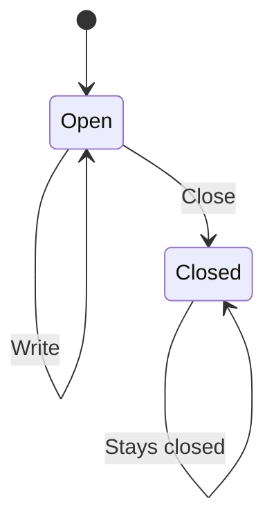

# Close an attachment

An open attachment can be closed. Writing is allowed only while it is open.
This copy of the model has the write guard removed, so the saved check shows
the rule that broke. This checks the design, not the code.

