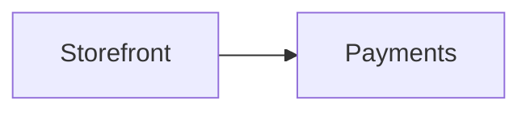
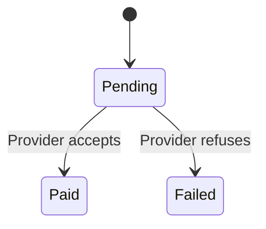
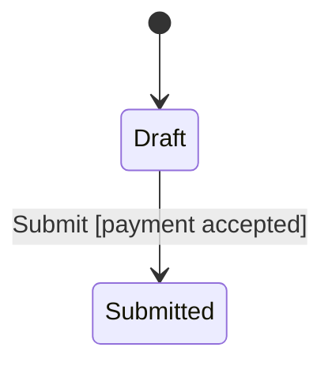

# Repository Markdown format

The local browser reads `docs/state` inside a selected project. Markdown is the
editable source. Generated SVG is a preview, not another document to maintain.

## Files and metadata

One system root lives at `docs/state/README.md`, with `parent: null`. Its ID need
not be `nessa`. All other documents name an existing parent ID. Keep folder
ownership consistent with that hierarchy. For example:

```text
docs/state/README.md
docs/state/services/payments/README.md
docs/state/services/payments/checkout/README.md
docs/state/services/payments/checkout/pay-for-an-order.md
docs/state/services/payments/payment-lifecycle.md
docs/state/gaps.md
```

Every page has YAML frontmatter and ordinary Markdown. Required fields:

```yaml
---
id: payment-lifecycle
title: Payment lifecycle
kind: statechart
status: implemented
summary: A payment can succeed, fail, or need another attempt.
parent: payments
sources:
  - src/payments.ts
diagramLinks: {}
---
```

IDs are stable lowercase kebab-case values. Titles and summaries are nonempty.
The root can use a project-specific title. Each `sources` entry is a project-relative
path; the browser checks existence but does not expose the source file's contents.
Use `[]` when there are no source references. The source remains the place for the
complete implementation.

| Field | Values |
| --- | --- |
| `kind` | `system`, `service`, `feature`, `flow`, `statechart`, `operation`, `contract`, `guide` |
| `status` | `implemented`, `mixed`, `fixture`, `proposed`, `reference` |
| `parent` | Another accepted document ID, or null for the root only |

Use `implemented` for behavior present in the inspected source, `fixture` for
examples or test wiring, and `proposed` for intended behavior that is not built.
Use `mixed` when a page includes more than one of those, and explain which parts.
Use `reference` for a guide or background material. A status is not a claim that
the code was deployed or that tests passed; report verification separately.

Unknown fields, duplicate IDs, missing parents, parent cycles and unresolved
diagram destinations are reported in Health. Folder/parent disagreement is a
warning. Each README owns the folder beneath it; metadata owns navigation. Do not
add a second navigation manifest.

Normal relative Markdown links to another accepted page navigate there. Source
links appear as references. HTML is not executed. A diagram uses a fenced
`mermaid` block. It can contain at most 100,000 UTF-16 code units, including
directives and comments. Split larger models at their actual owners.

## Source review checkpoint

Each page may record `sourceRevision` in its frontmatter:

```yaml
sourceRevision: "aa91831b5331d3461969f6a7be723a6d3325f29b"
```

This is the full lowercase Git commit ID (40 or 64 hexadecimal characters) of
**the documented repository's source reviewed for that page**. Quote it so YAML
keeps an all-numeric ID as text. Branch names, tags and short IDs are refused.
The value is authored evidence; the browser validates its form, not whether the
commit exists or the review was accurate.

The checkpoint lives in the repository being documented, under `docs/state`.
It is not the renderer's revision, the Markdown catalog's content hash, or the
commit that later adds the documentation. Do not use a self-referential future
commit ID. Record the source commit checked before committing the docs.

A page without this field displays “Source revision not recorded.” It does not
inherit a parent's or root's revision. A partial refresh advances only the pages
reviewed; navigation edits alone do not establish a fresh behavior audit. Keep
scope and exclusions in that page or its linked provenance notes. Do not claim
one atlas-wide revision when older pages have not been checked.

To investigate a later failure, read the page's full revision in Sources and
provenance and compare its linked source files at that commit with the failing
checkout. A checkpoint says what was reviewed, not that tests passed or that
newer commits are covered. Update it only after reconciling the page's behavior
against the newer source.

## Optional rule model

A page may link a TLA+ model of its chart. The model is optional. A page
without one is unchanged, and validation does not require a checker. When models
are authored, refreshed, or reported as verified, follow the required
[adversarial review and negative-control procedure](model-review.md). Catalog
validation and a saved `modelCheck` result alone do not satisfy that procedure.

Keep the model as files under `docs/state/tla/`, mirroring the page path. For
`docs/state/services/sdk/attachment.md`:

```text
docs/state/tla/services/sdk/attachment.tla
docs/state/tla/services/sdk/attachment.cfg
```

Link those files from the page. Paths are relative to `docs/state`, stay inside
`tla/`, and use no `..`. Each spec and each config is linked by exactly one page.
`validate:docs` reports a missing file or a shared file as an error.

```yaml
model:
  spec: tla/services/sdk/attachment.tla
  config: tla/services/sdk/attachment.cfg
  steps:
    Init: Start with the attachment open.
    Close: Close the attachment.
    Write: Write bytes.
```

`steps` is optional. Keys are TLC action names (`Init` is the initial state).
Values are one plain sentence each. The checker uses them for the failing path.
Diagram state ids should match the string values the model assigns (for example
a variable `phase = "Closed"` marks the chart state `Closed`).

The checker writes the last finished result. Do not hand-edit it to claim a
rule held. A model checks the design, not the code.

```yaml
modelCheck:
  sourceRevision: "aa91831b5331d3461969f6a7be723a6d3325f29b"
  checker: tlc-1.7.4
  date: "2026-11-02T08:12:00.000Z"
  config: tla/services/sdk/attachment.cfg
  modelDigest: "0123456789abcdef0123456789abcdef0123456789abcdef0123456789abcdef"
  states: 4
  held:
    - OnlyOpenOrClosed
  broke:
    - rule: NoWriteAfterClose
      path:
        - Start with the attachment open.
        - Close the attachment.
        - Write bytes.
      states:
        - Closed
  unchecked: []
```

`sourceRevision`, when present, is quoted and is a full lowercase commit id, the
same form as the page checkpoint. The checker records the page checkpoint it
saw, or the repository `HEAD` when the page has no checkpoint. `checker` is
`tlc-` plus the pinned TLC version. `date` is UTC. `config` is the config path
that was run. `modelDigest` is the SHA-256 of the spec bytes, a NUL, and the
config bytes. `states` is how many distinct states the last finished TLC run
reported. `held`, `broke`, and `unchecked` name TLC invariants and properties.
A broken rule has a plain-language path and the chart states where it failed.
A rule that the bound or the timeout did not finish is `unchecked`, never
`held`. `stop` is `states` or `time` when that limit is what stopped the run.

The chart badge "Rules checked at <short id>" is stale when the page checkpoint
and `modelCheck.sourceRevision` differ, or when the linked files no longer match
`modelDigest`.

## Drill-down

`diagramLinks` maps a Mermaid node ID to an accepted document ID:

```yaml
diagramLinks:
  Payments: payments
```



Only mapped nodes lead anywhere. A + marks them. Unmapped nodes stay neutral.
Clicking a mapped node shows the linked page's overview beside the chart, with
**Open page** to go there. The overview is the page's opening: the text between
its `#` title and its first `##` heading, without charts. A page with no opening
shows its `summary`. So open every page with a short paragraph that says what
it is and what it owns, and put the details under headings after it.

## State and decision explanations

`diagramDetails` is optional. It points to a heading in the same document, rather
than copying text into metadata:

```yaml
diagramDetails:
  - diagram: 0
    node: Pending
    section: Waiting for a reply
  - diagram: 0
    edge:
      from: Pending
      to: Failed
      label: Provider refuses
    section: Payment refused
```



```markdown
## Waiting for a reply

The payment request was sent, but the provider has not confirmed its result.
Waiting does not mean the payment succeeded.

## Payment refused

The provider refused this payment. The order remains unpaid. Explain the next
step supported by the actual implementation here.
```

`diagram` is the zero-based Mermaid block index. Select a `node` or an `edge`,
not both. Node IDs, endpoints and labels match the source exactly. `section` is
the exact plain heading text, unique in the document. A section includes its
nested headings and ends at the next heading at the same or higher level.
Headings inside lists or quotes do not define sections.

Bindings support `stateDiagram-v2` and ordinary `flowchart`/`graph` nodes and
plain labeled edges. Sequence messages and subgraph groups do not receive
explanation bindings. Duplicate edges with identical endpoints and labels are
ambiguous. Labels containing HTML, Markdown strings, Mermaid entity codes such
as `#quot;`, or a literal `|` cannot bind. Health reports a failed binding while
the page remains readable.

A node can have both navigation and an explanation. Its inspector shows the
explanation and offers the deeper page. Several elements may share a section.
Sequences in an explanation open in Details rather than creating another canvas
inside the inspector.

Standard shows the opening explanation, at most two blocks before a nested
heading. Full shows the whole authored section. Compact hides labels and notes
visually while preserving access to their explanations. Keep the important
condition and uncertainty in the first short paragraphs.

## Project config

A project can add one optional file, `docs/state/nessa-docs.yaml`. It is the
single place a project chooses its diagram cards, its reference pills, the
folders those pills may show, and its authoring rules. Without it a project
reads exactly as before. A skill that writes pages for this project reads this
file first (or calls `read_config` over MCP) and uses only what it lists.

```yaml
version: 1

cards:                       # optional; the four built-in cards always exist
  pairing: { look: handoff, label: Pairing }

references:                  # checked in order; the first match wins
  - name: adr
    match: 'ADR-?(?<n>\d{1,4})'
    label: 'ADR {n}'
    open:                    # tried in order; the first that resolves wins
      - { file: 'docs/adr/{n:04}-*.md' }                    # one file per ADR
      - { file: 'docs/decisions.md', heading: 'ADR-{n} *' } # one heading per ADR
  - name: issue
    match: 'nessa-agent#(?<n>\d+)'
    open: { url: 'https://github.com/nessalabs/nessa-agent/issues/{n}' }
  - name: page
    match: '\[\[(?<id>[a-z0-9-]+)\]\]'
    open: { document: '{id}' }

notes:                       # repository folders or files a pill may show
  - docs/adr
  - docs/decisions.md

authoring:
  requireSourceRevision: true

work:                        # optional; see Tracking work
  people: [saurav]           # who may accept a plan or answer a question
  quietAfter: 2h             # open work with no newer record is shown as quiet
  require:                   # extra needs per event; never new states or events
    merge: [check]
```

Each problem in the file is an `invalid-config` error in Health, and the valid
parts still apply: one bad pattern does not turn off the others. Unknown
sections and fields are refused rather than ignored.

### Diagram cards and state roles

A card is the frame drawn around one Mermaid chart. Name it on the fence; the
rest of the fence line is ignored by GitHub, so the page still renders there:

````markdown

````

| Card | For | What it adds |
| --- | --- | --- |
| `lifecycle` | `stateDiagram-v2` | States coloured by role, and a legend of the roles used |
| `handoff` | `sequenceDiagram` | A Handoff header and numbered steps (Mermaid `autonumber`) |
| `map` | `flowchart` / `graph` | A Map header |
| `plain` | any chart | Today's look |

A project card in `cards` gives a new name and label to one of these looks.
A card that is unknown, or that does not suit its chart (a `handoff` on a state
diagram), is a Health warning and is drawn as `plain`. `title` replaces the
heading caption in the card header.

A state role is a fixed meaning, so a colour means the same on every page:
`start`, `working`, `waiting`, `done`, `refused`, `uncertain`, `ended`. Tag a
state with Mermaid's own class syntax, `class Pending waiting` or
`Pending:::waiting`. Roles work in any state or flowchart chart. The role
names are reserved: a `classDef` of the same name is drawn with the role's
colour. Tag what the code makes true, not what you hope: `done` means the
outcome is final in the code you read.

### Reference pills

A reference pill is plain text that matches a `references` pattern. `ADR-202`
in a sentence becomes a pill; clicking it opens the referenced page, section or
note in a peek beside the page, with a way to open the page in full.

- `match` is a JavaScript regular expression. Named groups such as `(?<n>...)`
  fill the templates. A pattern that can take very long is refused: a group
  that repeats, such as `(...)+` or `(...){2,}`, may not hold a quantifier or a
  `|` at any depth, so `(a+)+`, `(?:(a+))+` and `(a|b)*` are refused while
  `(?:ADR|RFC)-\d+` is fine. So is one that uses back-references, is longer
  than 256 characters, or matches empty text.
- A match never splits a word: `XADR-1` and `ADR-12a` are not references.
  Matching looks inside one run of plain text only. Text in code, code blocks,
  link text, raw HTML and diagrams is never a pill, so write `` `ADR-1` `` to
  keep it literal.
- `label` is what the pill shows. `{0}` is the whole match, `{name}` a group,
  `{n:04}` the group padded with zeros to 4 digits.
- `open` is one target or a list, tried in order:
  - `{ document: '{id}', heading?: '...' }` opens an accepted page by its id.
  - `{ file: 'path/{n}-*.md', heading?: '...' }` opens a repository file. `*`
    is allowed only in the last part of the path. A value filled from a match
    cannot contain `/` or `..`. A file under `docs/state` opens as its page.
    Any other file is shown only when it is a Markdown file under a `notes`
    entry; otherwise the pill only names the file.
  - `{ url: 'https://...' }` opens a web page. Values are URL-encoded.
  - `heading` picks one section of the file, matched like a file glob against
    the heading text, ignoring case. The section ends at the next heading of
    the same or higher level.
- A target that matches two files or two headings is never guessed: the pill
  shows as unresolved with the reason, and Health lists it as
  `unresolved-reference`. So does a match that no target resolves.

The server finds and resolves every pill when it serves a page; the browser
draws them from that answer and never builds a link itself. Over MCP, `file`
targets do not exist (a bundle holds only `docs/state`), so use `document`
and `url` targets there.

### Glossary

Each package keeps its acronyms in one page named `glossary.md`. A glossary
covers its own folder and every folder below it, so `docs/state/glossary.md`
covers the whole project and `docs/state/services/sdk/glossary.md` adds the
SDK's own terms. Where two glossaries list the same term, the nearer one wins.
It is a normal page, with frontmatter like any other (`kind: guide`,
`status: reference`, `parent` the README of its folder).

Each entry is a `##` heading that is the term alone, with a paragraph under it
that says what the term stands for and what it is in this project:

```markdown
## SDK

Software development kit. The client library every agent links to send
commands to the gateway.
```

A term is one word of letters and digits, which may hold `+ & . / -` inside it
(`SDK`, `gRPC`, `TLA+`, `I/O`). Everything else is the definition: further
paragraphs, lists, and `###` subheadings belong to the entry.

Write a term as plain text; do not link it by hand. Every use of a term on a
covered page, written exactly or with a plural `s` (`SDKs`), becomes a link to
its entry: it is underlined with dots, shows the first paragraph on hover, and
opens the entry beside the page on click. As for pills, code, link text and
diagrams are left alone, a match never splits a word, and a project's own
`references` come first, so `ADR-12` stays an ADR pill when `ADR` is also a term.
No config is needed, and a project reference may not be named `glossary`.

Health checks a glossary in two ways, both as warnings:

- `invalid-glossary-entry`: a `##` heading that is not a term, a term listed
  twice in one glossary, or a term with no paragraph under it.
- `unlisted-acronym`: a covered page uses an acronym (two or more capitals,
  such as `CI`, `PR` or `HTTP2`) that none of its glossaries lists. The warning
  names the glossary to add it to. Write a word that is code in backticks.
  Pages that no glossary covers are not checked.

## Tracking work

A page can carry its own plan, and agents record progress next to it as plain
files. Nessa Docs reads both and draws them: each task's state outlines the box
or arrow it is anchored to, the sidebar shows the page's state, and the page
gets a Work view with every record. Nothing needs the app to be running.

### The lifecycle

Every page and task is in one of eight states, and only these events move it.
The list is fixed and ships with Nessa Docs in
[lifecycle.json](lifecycle.json); the validator and the reader both read that
file, so neither can disagree with it.

| Event | From | To | Needs |
| --- | --- | --- | --- |
| `accept` | draft | planned | a person (`work.people`) |
| `start` | planned | working | |
| `ask` | working | blocked | the question in the body |
| `answer` | blocked | working | a person |
| `submit` | working | review | evidence: a pr, commit, check or diff |
| `rework` | review | working | |
| `merge` | review | implemented | a commit in the evidence |
| `verify` | implemented | verified | a fresh rule check at the page's `sourceRevision` |
| `reopen` | implemented, verified | working | |
| `drop` | draft, planned, working, review | dropped | the reason in the body |
| `note` | any | (stays) | |

`stale` is never written. The reader shows an implemented or verified page as
stale when one of its `sources` changed in the checkout after its
`sourceRevision`. A project may add needs to an event under `work.require`
(any of `question`, `reason`, `evidence`, `commit`, `pr`, `check`,
`modelCheck`). It can never add, remove or rename a state or an event.

### The plan: a work block

```yaml
work:
  - id: timeout-cleanup
    title: Clean up when a start times out
    anchor: { diagram: 0, edge: { from: Starting, to: Cleaning, label: timed out } }
    dependsOn: [start-it]
```

`id` is a kebab-case id unique on the page. `title` is one line. `anchor`
selects a `node`, or an `edge` with its exact label, in the page's Mermaid
diagram number `diagram`, exactly as `diagramDetails` does. An anchor that
names nothing is a Health warning and the task is listed but not drawn.
`dependsOn` names other tasks on the same page. A malformed block rejects the
page like any bad field.

### The progress: one record per change

Each change of state is a new Markdown file. A page record sits at
`docs/state/work/<page>/<file>.md`; a task record at
`docs/state/work/<page>/<task>/<file>.md`. Name the file
`<at, with ":" as "-">-<by>.md`, such as `2026-11-10T07-40-00Z-codex.md`, so
two agents never write the same file.

```markdown
---
page: run-a-background-command
task: timeout-cleanup
event: submit
state: review
at: 2026-11-10T07:40:00Z
by: codex
model: <model id>          # optional, when the agent knows it
sourceRevision: "<full commit the agent was on>"   # optional
evidence:
  - pr: https://github.com/org/repo/pull/123
  - commit: "<full commit id>"
  - check: npm test
  - diff: src/runner.ts
---
Cleanup now runs when a start times out. The PR is open for review.
```

`page` and `task` repeat the folders the file sits in. `event` is one of the
events above and `state` is where it leads (for `note`, the current state).
`at` is UTC. `by` names who wrote it, in lowercase. The body is a sentence or
two; for `ask` it is the question, and for `drop` the reason. Unknown fields
are refused. Records under `docs/state/work` are never pages.

### How records are judged

The reader replays a page's records oldest first (by `at`, then file path)
through the lifecycle. A record that cannot be read is `invalid-record`; one
for a page or task that does not exist is `unknown-work-page` or
`unknown-work-task`; one the lifecycle does not allow from the current state,
or that lacks what its event needs, is `refused-record`. All are errors in
Health and in `validate:docs`, and none of them moves a box. Fix a mistake with
a newer record, never by editing the old one.

A task starts in `draft` and becomes `planned` when its page is accepted; until
then a task can only be dropped or noted. A page with tasks follows them: its own records may only `accept`, `drop`,
`verify` or `note` it. It is `blocked` while any task is blocked, `review`
only when every task that is not dropped is in review or finished, and
`implemented` only when all of them are implemented. A page with no tasks
moves on its own records. A person's move (`accept`, `answer`) is accepted only
when `by` is listed in `work.people` and the record names no `model`. A file
cannot prove who wrote it, so this is a rule the project keeps by review; a
project that needs more can require signed commits.

The reader shows how old the newest record is. After `work.quietAfter`
(default 2h) open work is drawn as quiet: the record says what was last
written, never that an agent is still running.
